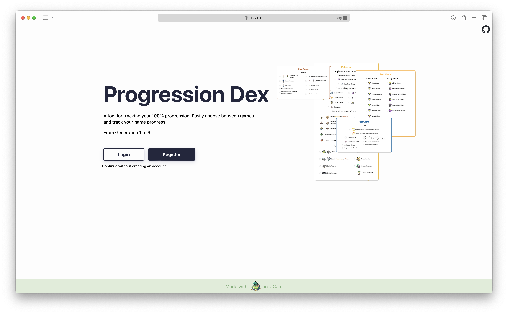
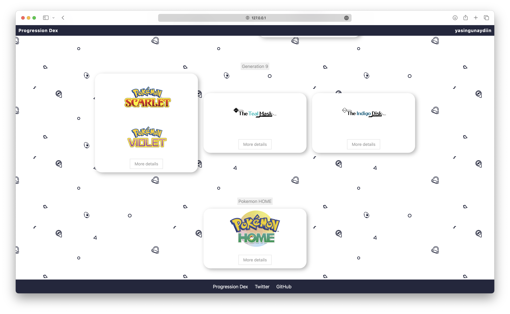
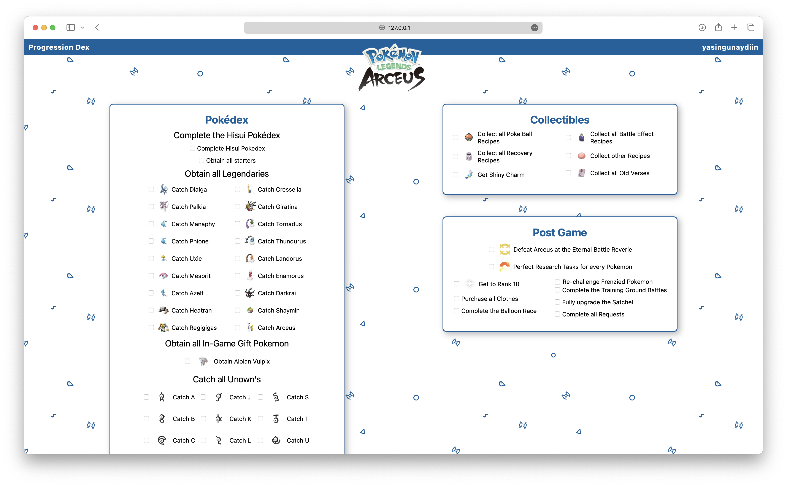

# Progression Dex

A tool for tracking your 100% progress in Pokemon games. Pick a game, tick things off, and watch the progress bar fill.

## Features

- Checklists for 26 games and apps (Red/Blue through Scarlet/Violet DLC, plus Pokemon Home)
- Progress bar per game, struck-through sections once complete, confetti at 100%
- In Progress / Completed badges and filters on the game list
- Progress is saved in your browser (`localStorage`) - no account needed
- **Export / Import** buttons (bottom-right) back your progress up to a JSON file, so clearing browser data or switching devices doesn't lose it

## Screenshots







## Accounts and sync (optional)

By default nothing leaves your browser. If you want sign-in and syncing across devices, the site can use [Supabase](https://supabase.com) (free tier). Without the steps below the site behaves exactly as before and no sign-in button is shown.

1. Create a Supabase project.
2. In the SQL editor run [supabase/schema.sql](supabase/schema.sql). It creates the `progress` table and row level security so people can only read and write their own rows.
3. Under Project Settings > API copy the project URL and the `anon` public key into [config.js](config.js).
4. Under Authentication > URL Configuration add your site address (for example `http://localhost:8000` and your real domain) as the Site URL / redirect URLs so confirmation and password-reset emails come back to the site.

How it behaves: checkboxes always live in `localStorage` first, so the site works offline and for people without an account. When signed in, every change is also saved to the account. The first time a browser signs in, ticks from the browser and from the account are merged (nothing is lost); after that the most recent change wins per game.

## Development

It is a static site; there is no server code. Serve the repo root with any static file server (for example `python3 -m http.server`) and open `index.html`.

```sh
npm install
npm run dev     # rebuild output.css (Tailwind + DaisyUI) on change
npm run build   # one-off minified build of output.css (commit the result)
npm run check   # validate checkbox ids, label links and local file references
npm run format  # prettier
```

### Layout

- `index.html`, `list/` - landing page and game picker
- `checklists/<game>.html` - one page per game; each checkbox needs a unique id of the form `<game>-checkbox-<name>`
- `checklists/js/script.js` - shared behaviour (persistence, progress, theme switching); `backup.js` - export/import
- `checklists/css/base.css` + `<game>.css` - shared and per-game styles
- Games with two versions switch theme by clicking a logo: give the `` `data-theme-color` and `data-theme-pattern` attributes

Not affiliated with Nintendo, Game Freak or The Pokemon Company.
